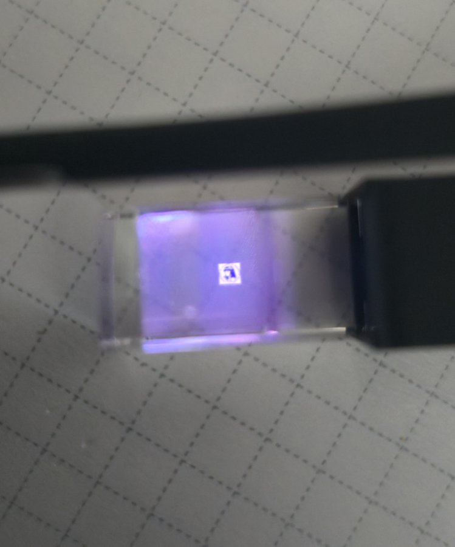
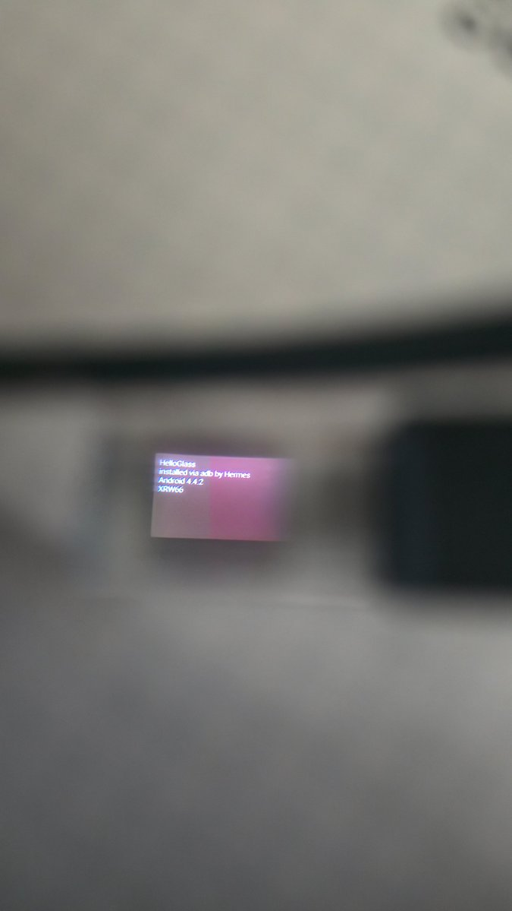

I ended up with a first-generation Google Glass Explorer Edition and wanted two things from it: a root shell and the ability to install whatever apps I felt like. What I got instead, on first plug-in, was a setup wizard asking whether I wanted to connect by *phone or computer* — and both answers are lies in 2026. The MyGlass app is gone from every app store, and `glass.com/setup` returns a 404. The wizard is a lock with no key.

So we picked the lock. Everything below is reproducible — the full guide, scripts, and research notes live in [glass-explorer-jailbreak](https://github.com/christopherwoodall/glass-explorer-jailbreak).



---

## The State of the Art (2013)

Google *documented* a root path for Glass: `fastboot oem unlock`, then flash a **rooted boot image** that Google itself published per firmware version. The rooted ramdisk sets `ro.secure=0`, which makes `adbd` accept connections as root with no RSA prompt. Half of that chain has rotted — the XE23/XE24 rooted-boot links on Google's archived docs now return GCS `AccessDenied` — but the Internet Archive preserved the exact bytes, and the published SHA1s prove it.

**WARNING:** `fastboot oem unlock` erases all data on the device and, in spirit, voids a warranty that expired during the Obama administration. If your Glass is stuck in the setup wizard, there is nothing on it to lose.

---

## The Bootloader Problem

The moment you put a Glass in fastboot and try to flash it with a modern platform-tools build, everything hangs:

```
Sending 'boot.img' (5496 KB)
```
…and then nothing, forever. This is not a driver problem. The 2013 OMAP bootloader **does not implement `fastboot getvar`** — it simply never answers — and modern fastboot clients block forever waiting for a `max-download-size` reply that will never come. Worse, a *locked* Glass refuses image downloads outright with a bare `FAIL`, which looks exactly like a broken cable.

The fix was to speak the fastboot protocol directly over libusb. A couple hundred lines of Python (`fb.py`) finds the device at Google's vendor ID, claims the vendor-class interface, and streams images in 16 KB chunks at ~20 MB/s. It also exposed the best protocol quirk of the whole project: `oem unlock` is a **two-shot** command, and the first run's `OKAY` only means *"message shown, run me again to confirm."* People have almost certainly bricked Glass units by stopping there.

---

## The Ride-Along Boot Image

With the bootloader unlocked, Google's rooted boot image is flashable — but on a freshly-wiped unit it still won't give you adb. Here's why: during boot the framework picks its own USB function, and Glass's default is **`ptp`** (photo sync). The gadget comes up in photo mode, `adbd` never starts, and the setup wizard is still the only thing on screen.

My first fix intercepted the property with init triggers (`sys.usb.config=ptp` → set it back to `adb`). This put init and the framework's `UsbDeviceManager` into a property ping-pong that crash-looped system_server into a very photogenic boot-loop. Lesson learned the hard way: **don't fight the framework; ride along with it.**

The working patch edits `init.omap4430.usb.rc` inside the ramdisk so that when the framework asks for `ptp`, the gadget comes up as a **composite** — `functions ptp,adb` — and `start adbd` runs as a bonus line. The framework gets exactly what it asked for; we silently ride along with a root shell. Glass uses the same USB PID (`0x9001`) for every gadget mode anyway, so nothing on the wire changes except that adb exists.

Everything else in the image is byte-identical to Google's: same kernel, all 40 ramdisk entries preserved. The builder in the repo is deterministic — it re-parses its own output and produces the same sha256 every run.

The 60-second version:

```bash
# Glass in fastboot (off → hold camera + power 10–15 s → plug in)
python3 tools/fb.py oem unlock                  # run TWICE
python3 tools/fb.py oem unlock                  # "Device unlocked!"
python3 tools/build_ridealong.py boot-XE24-rooted.img ridealong.img
python3 tools/fb.py flash boot ridealong.img
python3 tools/fb.py reboot
adb shell id                                    # uid=0(root)
```

No prompts. No Debug Mode toggle. No wizard. Root on every boot, forever, because it lives in the boot image.

---

## Reclaiming the Device

Fingerprint after first boot told a fun story: `Google/glass_1/glass-1:4.4.2/XRW66` — an **XE21** system wearing an **XE24** rooted kernel, booting stable. With uid 0 the wizard's reign ended immediately:

```bash
adb shell pm disable com.google.glass.setup     # Package ... new state: disabled
```

Boots now land on the clock. The real Settings app (`com.google.glass.settings.ui/.SettingsActivity`) launches on demand over adb. And since Glass has no app drawer, third-party apps become *tappable* through a voice trigger — a few manifest lines put your app in the "ok glass" menu, where menu entries are selectable by tap. The repo includes a demo app that displays the classic Nous Research seal on the 640×360 prism.

Proof of life — a test app, built from scratch on the host and pushed over adb, doing its thing on the actual display:



---

## Wi-Fi, Remote Access, and `su`

Root opens the rest of the device without any of Google's scaffolding:

- **Wi-Fi**: append a standard network block to `/data/misc/wifi/wpa_supplicant.conf` as root, `svc wifi enable`. (Glass's on-device QR scanner expects a *nonstandard* text QR — `email=...&ssid=...&psk=...&version=1&enc=1` — there's a generator script in the repo.)
- **Remote access**: no sshd ships on the device, but there's `adb tcpip 5555` for wireless adb, and the bundled busybox includes `telnetd` if you want a network shell on a trusted LAN.
- **On-device `su`**: release images ship no `su` binary; the guide covers remounting `/system` and installing one from a source you trust. Note that with `ro.secure=0`, adb *is* root already — most workflows never need it.

---

## Repair Notes

Every failure mode in this project was survivable because only the `boot` partition was ever touched. A boot-looping image is a one-command revert to the stock factory boot; a wedged fastboot (killed transfers leave the USB firmware in a state where even control transfers time out) is fixed by a physical power cycle, nothing else. The full troubleshooting matrix — including the exact reason modern fastboot stalls and why PID `0x9002` means bootloader while PID `0x9001` means *every* gadget mode — is in the guide.

---

## Resources

- [glass-explorer-jailbreak](https://github.com/christopherwoodall/glass-explorer-jailbreak) — full guide (`GUIDE.md`), fastboot client, boot-image builder, app build chain, research notes
- [Glass Explorer system downloads (archived)](https://developers.google.com/glass/tools-downloads/system) — Google's original root procedure and factory images
- [Exploiting a Bug in Google's Glass (Saurik, 2013)](https://www.saurik.com/googleglass.html) — the classic adb-restore race, for the locked-bootloader purists
- [Glass EE2 system images](https://developers.google.com/glass-enterprise/downloads/system-images) — the enterprise successor, a different animal entirely
