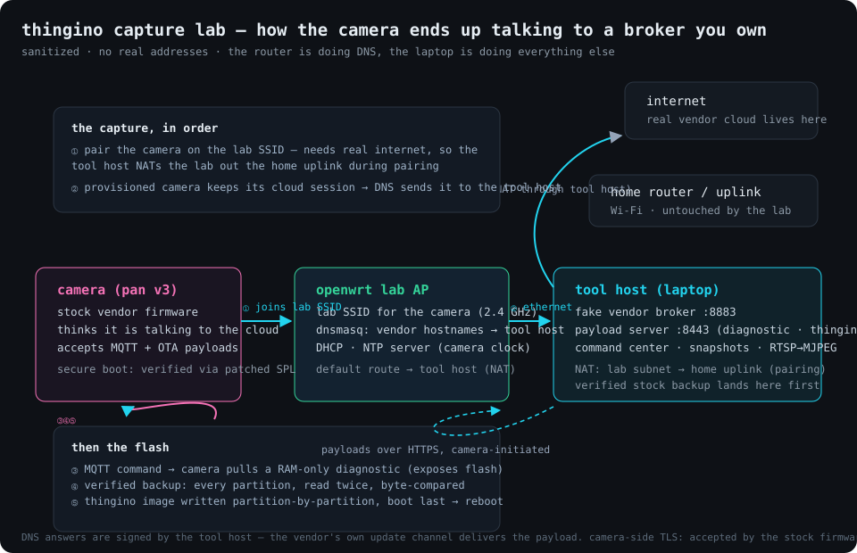

I bought a Wyze Cam Pan v3 because I wanted exactly two things from it: a local RTSP stream and pan/tilt control from my own software. Wyze's answer to both is *the cloud* — the app, the account, the subscription upsell, and a camera that phones home even to pan left. The camera itself is lovely hardware: an Ingenic T31X SoC, a GC2053 sensor, an ATBM6031 radio, and stepper motors on GPIO pins, all begging to be run by something open.

The catch, per every wiki on earth: the Pan v3's SoC has **secure boot fused on**. `wz_mini_hacks` — the tool that made Wyze v2/v3 cameras famously hackable — lists `HL_PAN3` as *"Not Supported … can not be disabled without replacing the chip."* I believed that for about a week, until thingino's community found what the vendor missed: **the signature check only verifies the first 32 bits of the signature** ([CVE-2026-50720](https://nvd.nist.gov/vuln/detail/cve-2026-50720)). thingino's `master` builds now ship a patched SPL that satisfies the broken check. Two community Pan v3 units booted it. Mine is number three.

Everything below is reproducible — tooling, the verified backup layout, and research notes live in my `wyze-command-center` project, and the heavy lifting is [joeblack2k/wyze-v3-ota](https://github.com/joeblack2k/wyze-v3-ota) plus [thingino](https://github.com/themactep/thingino-firmware).



---

## Three ways in, one that doesn't need a screwdriver

The secure boot rules out the classic SD-card trick — the stock bootloader only runs vendor-signed images, and thingino's SD installers don't cover this model. The thingino wiki describes three real paths: USB boot through a hidden connector in the pan base, a flash-chip pin-short (SOIC-8, pins 5+6), and the one I picked: **let the camera flash itself through its own update channel.**

The vendor update flow has three load-bearing properties:

1. The camera trusts its MQTT broker (`aws-iot.wyzecam.com`) — *if DNS says so*.
2. The broker can push a plaintext upgrade command with an operator-supplied payload URL.
3. The stock updater downloads a `.tar`, extracts `upgraderun.sh`, and runs it **as root**.

If you own the DNS for those hostnames, the camera happily accepts a broker you run, a diagnostic payload that exposes its flash, and finally a thingino image delivered partition-by-partition. No disassembly. The tool: `wyze-v3-ota`, which also refuses to flash anything until it has taken a **verified full backup** — every partition read twice through independent paths and byte-compared. With Wyze having pulled their firmware images from their own support site, that backup is the only road back. I treated it accordingly.

---

## The capture problem (or: why ARP poisoning doesn't work here)

My first instinct was the classic: ARP-poison the camera so its traffic flows through my laptop, then redirect DNS there. That died for a boring, structural reason — **this camera learns the gateway's MAC passively from the DHCP exchange** (the L2 source address of the OFFER/ACK) and never emits an ARP request for the gateway. It also ignores unsolicited ARP claims, unicast and broadcast alike. Two spoofer implementations, a self-testing responder, pf counters reading 222,094 evaluations and zero matched packets: the camera's traffic simply never transits you.

The fix was to stop being clever and own the network properly: an **OpenWrt router as the camera's AP**, where `dnsmasq` answers the vendor's hostnames authoritatively:

```
# on the lab router — the "MITM" is now just DNS
uci add_list dhcp.@dnsmasq[0].address='/aws-iot.wyzecam.com/<tool-host>'
uci add_list dhcp.@dnsmasq[0].address='/wyze-firmware-upgrade-service.wyzecam.com/<tool-host>'
uci add_list dhcp.@dnsmasq[0].address='/s3-us-west-2.amazonaws.com/<tool-host>'
```

The camera joins the lab SSID, resolves the vendor's cloud to my tool host, and its steady-state MQTT session lands on a broker I run. From there the tool publishes the upgrade command and the stock updater does the rest — to itself, as root, with a verified backup taken first.

---

## The subtlety that cost me a day: pairing needs *real* internet

I factory-reset the camera before putting it on the lab network, assuming a fresh device plus a fake cloud would be fine. Wrong — **app pairing requires genuine vendor-cloud connectivity** to bind the account, and a captive-only lab network makes the camera fail pairing, drop its lease, and revert to setup mode. It would sit there, associated, silent, never starting the cloud session the whole exploit depends on.

The resolution is in the diagram's dashed path: the tool host **NATs the lab out the home uplink during pairing**. The camera completes a normal, fully-account-bound pairing *on my network*, and only then does the redirect matter — because a provisioned camera continuously maintains its MQTT session, and my DNS has been pointing that session at my broker since before it connected. Pair first (real internet), capture second (fake cloud). The OpenWrt router got its uplink as a 5 GHz STA joined to the home network; when that radio (mwlwifi — abandoned driver) refused to pass data to an 802.11ax gateway, the laptop itself became the lab's NAT gateway, which worked and needs no extra hardware.

---

## The 90-second version

```bash
# 1. build the image (Image Builder, master branch, exact model string)
#    model: wyze_campan3_t31x_gc2053_atbm6031

# 2. lab network (openwrt): SSID + dnsmasq redirects + NTP, see diagram
#    tool host: NAT the lab subnet out the home uplink

# 3. pair the camera onto the lab SSID with the Wyze app (real internet = success)

# 4. capture and flash (tool host, python ≥3.11):
./bin/wyze-v3-ota serve   --cert pki/fullchain.pem --key pki/server.key \
                          --payload-dir build
./bin/wyze-v3-ota sessions --          # the camera's MAC appears here
./bin/wyze-v3-ota upgrade  --mac <MAC> --payload build/4.50.18.99.tar \
                           --public-host wyze-firmware-upgrade-service.wyzecam.com
./bin/wyze-v3-ota backup   --host <CAM_IP> --out-dir backups/<MAC>
./bin/wyze-v3-ota verify-backup --manifest backups/<MAC>/backup-manifest.json
./bin/wyze-v3-ota flash    --mac <MAC> --host <CAM_IP> \
                           --image build/thingino-wyze-campan3.bin \
                           --backup-manifest backups/<MAC>/backup-manifest.json --yes
```

`mtd4 ok / mtd5 ok / mtd2 ok / mtd3 ok / mtd1 ok` — config, OEM, rootfs, recovery, kernel — and the boot partition, written last, always. Reboot: the camera forgets Wyze ever existed.

---

## What you get

thingino first-boots its own access point; you give it real Wi-Fi from your phone and it never thinks about a vendor cloud again. On my network it serves:

- **RTSP**: `rtsp://thingino:thingino@<ip>/ch0` — 1080p H.264, ~30 fps, plus an SD substream on `ch1`
- **Web UI** with motor controls, ONVIF, SSH (`root`, change it), MQTT, Frigate/Home-Assistant integrations
- Pan/tilt GPIO mappings already in the board definition — the motors just work

On my side the cameras feed a small FastAPI command center: one MJPEG producer per camera, a multi-camera registry with LAN scanning, pan/tilt through thingino's motor API, snapshots, and segment recording — all reachable over Tailscale from anywhere. The Pan v3's 1080p stream has been rock solid; the D-pad latency over the LAN is about one stepper-jerk per 350 ms, which is exactly as charming as it sounds.

---

## Gotchas worth their ink

- **Image builds are strict**: website/release builds die at SPL clock init on this camera. Only `master`-branch builds with the exact model string (`wyze_campan3_t31x_gc2053_atbm6031`) boot.
- **The SD card cannot start the flash** on a stock Pan v3 — secure boot again. SD recovery (`autoupdate-full.bin`) only works *after* thingino's U-Boot is installed. Keep it; it's the un-brick button.
- **Don't factory-reset before pairing onto the lab network** (see the pairing subtlety above). Provision first, capture second.
- **A `$` in any credential silently breaks docker-compose env files** — everything after the `$` is eaten. Ask me how I know.
- **mwlwifi (WRT-series Linksys) STA mode cannot exchange data with 802.11ax gateways** — association and WPA succeed, then zero frames return, forever. If your lab uplink needs Wi-Fi, don't use a WRT for it.
- **macOS will happily make a new wired interface the default route** the moment it links, killing your internet on a no-WAN lab. Flip the network service order so Wi-Fi stays primary: `networksetup -ordernetworkservices "Wi-Fi" "Ethernet" ...`
- **Back up like it's load-bearing, because it is.** Wyze pulled their firmware from their own support site. The verified backup and the `autoupdate-full.bin` SD image are the entire recovery story.

---

## Why this matters beyond one camera

The same shape repeats across the cheap-camera ecosystem: capable silicon, motors, sensors and radios, gated behind an account and a cloud that can be revoked at any time. Thingino's find — that a vendor's secure boot implemented its *own* verification so poorly that a third party could satisfy it — turns a locked camera into general-purpose hardware. The tooling treats the vendor's own trust channel as the delivery mechanism and keeps the escape hatch (a verified backup) as a first-class artifact.

The camera now watches my workshop, streams 1080p over my LAN, and has never heard of a subscription.
